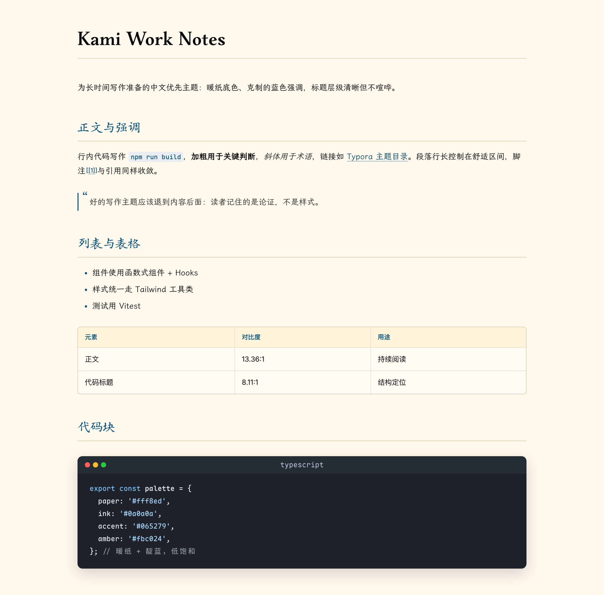
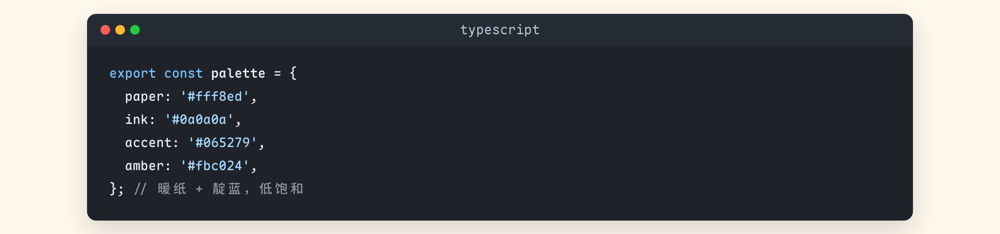
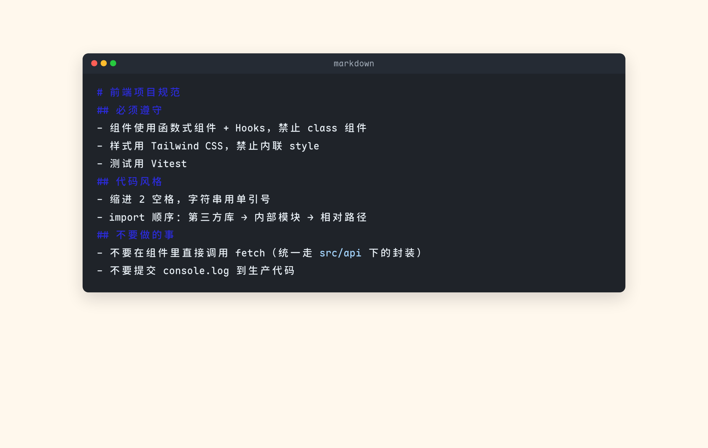
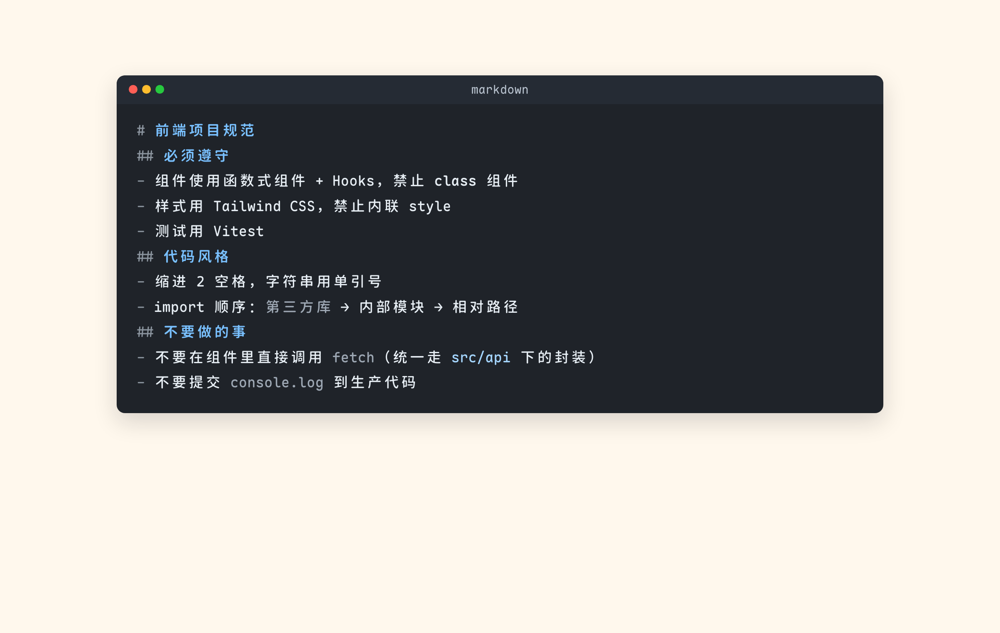

# Kami Work Notes

一个为**中文长文写作**准备的 Typora 主题：暖纸底色、靛蓝强调、克制的语法高亮。目标是让读者记住论证，而不是样式。

适合论文、教学讲义、技术笔记这类需要长时间盯屏的场景。



## 特性

- **暖纸底 `#fff8ed`**：长时间阅读比纯白柔和，导出打印也不刺眼
- **标题层级靠字体与粗细区分**：一级标题用衬线（上图东观体），二级以下用楷体系，而不是靠越来越浅的灰色
- **低饱和 GitHub Dark 代码窗口**：代码块做成 macOS 窗口样式，红黄绿圆点 + 语言标签，语法高亮压低饱和度
- **代码块内 markdown 语法可读**：`` ```markdown `` 里的标题、链接、标记符都有专门配色（见[下文](#修复记录)）
- **中文优先排版**：正文走霞鹜文楷，代码走 Maple Mono NF CN，数字与西文走 Inter
- **表格 / 引用 / 脚注统一收敛**：细线框、暖色表头、脚注用 `[1]` 方括号编号

## 配色

主题的调色板集中在 `:root` 变量里，改一处即可换风格。

| 变量 | 色值 | 用途 |
| --- | --- | --- |
| `--kami-paper` | `#fff8ed` | 正文纸底 |
| `--kami-paper-raised` | `#fffaf2` | 表格、卡片、侧栏 |
| `--kami-paper-tint` | `#fff3dc` | 表头、强调底 |
| `--kami-ink` | `#0a0a0a` | 正文墨色 |
| `--kami-muted` | `#6e6a64` | 次要信息 |
| `--kami-blue` | `#065279` | 强调靛蓝 |
| `--kami-amber` | `#fbc024` | 高亮标记 |
| `--kami-red` | `#e84a5f` | 警示 |
| `--kami-dark-panel` | `#1e2029` | 代码窗口底色 |

代码窗口内的 token 配色（固定色值）：

| token | 色值 | 对比度（底色 `#1f2329`） |
| --- | --- | --- |
| 正文 / 变量 | `#e6edf3` | 13.36:1 |
| 标题、关键字 | `#79c0ff` | 8.11:1 |
| 字符串 | `#a5d6ff` | 10.27:1 |
| 数字、类型、属性 | `#d2a8ff` | 8.4:1 |
| 标记符、注释 | `#8b949e` | 5.13:1 |
| HTML 标签 | `#7ee787` | 10.27:1 |

## 字体依赖

主题不会内置字体文件，按 `local()` 名称匹配本机字体，缺了会自动降级：

| 用途 | 首选 | 降级 |
| --- | --- | --- |
| 一级标题 | 上图东观体 / STDongGuanTi | 霞鹜文楷 → 系统衬线 |
| 二级以下标题 | 汇迹正楷 / CooperZhengKai | 霞鹜文楷 → 系统衬线 |
| 正文 | 霞鹜文楷 LXGW WenKai | 苹方 → 宋体 |
| 西文与数字 | Inter | 苹方 → Helvetica Neue |
| 代码 | Maple Mono NF CN | SF Mono → JetBrains Mono → Menlo |

想要完全一致的效果，装 [霞鹜文楷](https://github.com/lxgw/LxgwWenKai) 和 [Maple Mono](https://github.com/subframe7536/maple-font)；不装也能正常用，只是字面观感不同。

## 安装

```bash
# 1. 拷贝主题文件
cp kami-work-notes.css "$HOME/Library/Application Support/abnerworks.Typora/themes/"

# 2. 重启 Typora（或切换一次主题），在 主题 菜单里选 Kami Work Notes
```

Windows 放到 `%APPDATA%\Typora\themes\`，Linux 放到 `~/.config/Typora/themes/`。

可选：代码块右上角的复制按钮需要额外的 JS 扩展注入（CSS 里已有按钮样式），不装不影响主题本身。

## 截图

| 代码块 | 修复前（深蓝标题读不清） | 修复后 |
| --- | --- | --- |
|  |  |  |

## 修复记录

**2026-10-19 · 代码块内 markdown 语法对比度**

主题把代码块做成了深色窗口（`#1f2329`），但早期版本没有覆盖代码块内的 markdown 语法配色，于是 `` ```markdown `` 代码块里的标题继承了 Typora 亮色主题的深蓝 `#2b2bd5`，对比度仅 **1.81:1**，几乎不可读。

已按主题自身的调色板补齐 `cm-header`、`cm-link`、`cm-formatting` 等 token：标题 `#2b2bd5 → #79c0ff`（1.81 → 8.11），标记符压成 `#8b949e`，窗口标题栏文字 `#9da7b3 → #b9c3cf`（5.84 → 7.99）。

## 目录

```
kami-work-notes.css     主题本体（单文件，无外部资源依赖）
screenshots/            展示与对比截图
thumbnails/             主题站用 250×200 缩略图
backup/                 作者本机的 Typora 配置备份，与主题无关，可忽略
```

`backup/` 里是个人备份：清洗过的偏好设置、粘贴图片、其他在用主题、还原与同步脚本。安装本主题**不需要**这部分内容，见 [backup/README.md](backup/README.md)。

## License

[MIT](LICENSE)
